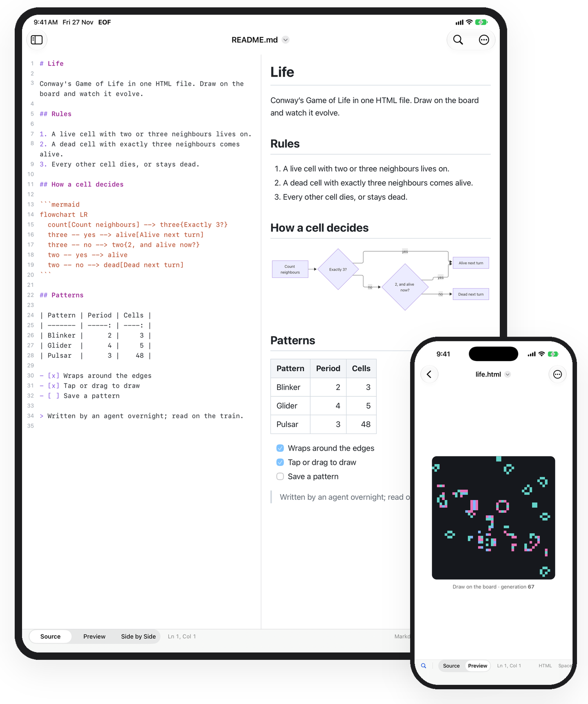
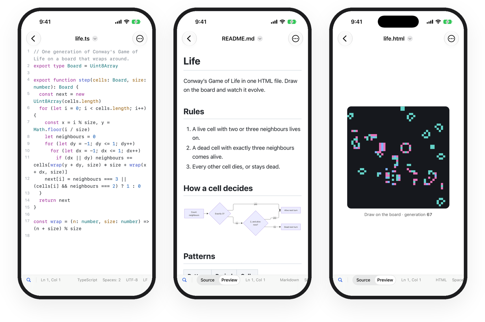

<div align="center">

<a href="https://geteof.app"></a>

# EOF

### End of file. Time to read.

Read the code, Markdown and HTML your agent wrote, on iPhone and iPad.

[](https://testflight.apple.com/join/uJPkDruK) [](https://geteof.app) [](https://github.com/geteof/eof/stargazers) [](LICENSE)<br>
  

[English](README.md) · [简体中文](README.zh-CN.md)

<picture>
  <source media="(prefers-color-scheme: dark)" srcset="docs/screenshots/hero-dark.png">
  
</picture>

</div>

## Is EOF for you?

You let a coding agent work while you are away from the desk. It leaves you a diff of TypeScript, a README with tables and diagrams, and an HTML page with a script in it. EOF is the place to read all three on your phone: the code in colour, the Markdown laid out, the HTML running, and the raw source one switch away.

EOF opens single files. It is a reader first; it also edits, but it is not an IDE and does not open folders, run builds or talk to Git.

## Install

- **TestFlight (free public beta):** <https://testflight.apple.com/join/uJPkDruK>
- **App Store:** coming soon.

Requires iOS or iPadOS 17 or later. Open a file from the Files app, from another app's share sheet, or by dropping it onto EOF.

## What it does

<p align="center"><picture>
  <source media="(prefers-color-scheme: dark)" srcset="docs/screenshots/phones-dark.png">
  
</picture></p>

### Code, in colour

Syntax highlighting for 50+ languages, parsed with [Tree-sitter](https://tree-sitter.github.io/) through [Runestone](https://github.com/simonbs/Runestone). Regex find and replace, an outline of functions and headings, go to line, and a compare view for two files. Eight light and dark themes.

### Markdown, rendered

One switch between **Source**, **Preview** and, on iPad and wide windows, **Side by Side**, where the preview follows as you type. Headings, tables, code blocks, task lists and [Mermaid](https://mermaid.js.org/) diagrams. Raw HTML inside a Markdown file is shown as text, never run.

### HTML, live

HTML opens in a real web view. JavaScript is off by default; turn it on in Settings and buttons, forms, canvases and animations run inside the preview. Links open in your browser instead of replacing the page.

### Everything else

- PDF, images, video and Office documents open in a viewer; any other binary opens as hex.
- Detects 19 text encodings and converts between CRLF and LF.
- Format and minify JSON, Base64 encode and decode, sort lines.
- Wrap lines, show invisibles, bigger and smaller text, multiple windows on iPad, keyboard shortcuts.

## Build from source

You need a Mac with a current Xcode and [XcodeGen](https://github.com/yonaskolb/XcodeGen).

```sh
brew install xcodegen
git clone https://github.com/geteof/eof.git
cd eof
xcodegen generate
open EOF.xcodeproj
```

Set your own team under **Signing & Capabilities** (or change `DEVELOPMENT_TEAM` in `project.yml`), pick an iPhone or iPad simulator, and run. Swift packages resolve on the first build.

The UI-free core is a Swift package that also builds on Linux:

```sh
cd EOFCore
swift test
```

## Repository layout

| Path | What lives there |
| --- | --- |
| `App/` | The SwiftUI app: editor, previews, settings, resources and highlight queries |
| `EOFCore/` | Platform-independent logic: languages, encodings, Markdown to HTML, text transforms; tested with `swift test` |
| `Grammars/` | Tree-sitter grammars that have no usable Swift package, vendored at pinned revisions by `Tools/grammars.py` |
| `Samples/` | Files for trying every viewer: a small Game of Life project (code, Markdown, live HTML), encodings, binaries, media |
| `Tools/` | Scripts that regenerate grammars, Material icons and the acknowledgements page |
| `project.yml` | The XcodeGen project description |

## Privacy

No account, no server, no analytics, no ads. EOF reads and writes only the files you open, and they stay on your device. A Markdown or HTML preview may load remote images or scripts that the document itself references. See the [privacy policy](https://geteof.app/privacy).

## Contributing

Issues and pull requests are welcome. Please describe what you saw and on which device, and attach the file when you can. Run `swift test` in `EOFCore` before you send a change, and say how you checked any UI change on a device or simulator. Notes for coding agents working in this repository are in [`AGENTS.md`](AGENTS.md).

## Acknowledgements

EOF stands on [Runestone](https://github.com/simonbs/Runestone), [TreeSitterLanguages](https://github.com/simonbs/TreeSitterLanguages), the Tree-sitter grammars of many authors, [swift-markdown](https://github.com/swiftlang/swift-markdown), [Mermaid](https://mermaid.js.org/) and [Material Icon Theme](https://github.com/material-extensions/vscode-material-icon-theme). Their licences are in [`ThirdPartyNotices.md`](ThirdPartyNotices.md) and on the Acknowledgements page in the app.

## License

[MIT](LICENSE). Third-party components keep their own licences; see [`ThirdPartyNotices.md`](ThirdPartyNotices.md).
