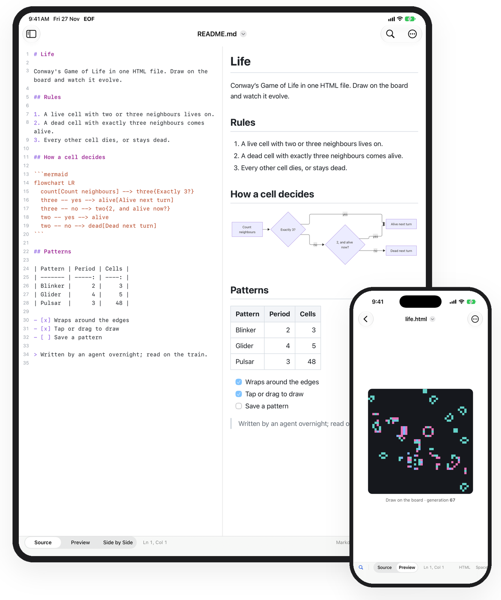
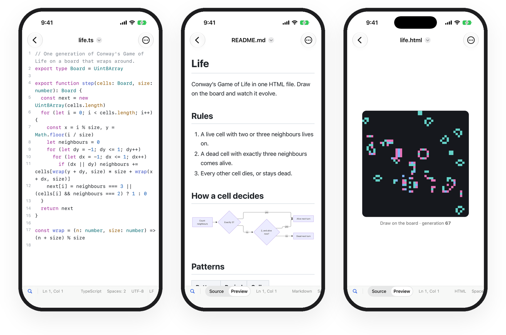

<div align="center">

<a href="https://geteof.app"></a>

# EOF

### 文件到此写完，阅读由此开始

在 iPhone 和 iPad 上，阅读 Agent 写下的代码、Markdown 与 HTML。

[](https://testflight.apple.com/join/uJPkDruK) [](https://geteof.app) [](https://github.com/geteof/eof/stargazers) [](LICENSE)<br>
  

[English](README.md) · 简体中文

<picture>
  <source media="(prefers-color-scheme: dark)" srcset="docs/screenshots/hero-dark.png">
  
</picture>

</div>

## EOF 适合你吗？

离开工位时，你让编程 Agent 继续干活。它留下了一份 TypeScript 改动、一篇带表格和图表的 README，以及一个内嵌脚本的 HTML 页面。EOF 就是用来在手机上把这三类文件一次看清的地方：代码带语法高亮，Markdown 排版清晰，HTML 直接运行，一键即可切回原始源码。

EOF 只打开单个文件。它首先是一款阅读器，也支持编辑，但它不是 IDE，不打开文件夹、不运行构建，也不接入 Git。

## 安装

- **TestFlight（免费公测）**：<https://testflight.apple.com/join/uJPkDruK>
- **App Store**：即将上线。

需要 iOS 17 或 iPadOS 17 及以上版本。你可以从「文件」App、其他应用的分享菜单打开文件，或直接将文件拖放到 EOF 中。

## 主要功能

<p align="center"><picture>
  <source media="(prefers-color-scheme: dark)" srcset="docs/screenshots/phones-dark.png">
  
</picture></p>

### 代码高亮阅读

支持 50+ 种语言的语法高亮，通过 [Runestone](https://github.com/simonbs/Runestone) 集成 [Tree-sitter](https://tree-sitter.github.io/) 解析。内置正则查找替换、函数与标题大纲、跳转到指定行以及双文件对比视图，提供 8 套浅色与深色主题。

### Markdown 渲染预览

一键切换 **源码**、**预览**，在 iPad 和宽屏窗口下还可切换到 **双栏**，预览随输入实时更新。支持标题、表格、代码块、任务列表及 [Mermaid](https://mermaid.js.org/) 图表。Markdown 文件中的原始 HTML 会按纯文本显示，不会被执行。

### HTML 实时预览

HTML 文件在真正的 Web View 中打开。默认关闭 JavaScript；在设置中开启后，按钮、表单、画布与动画都能在预览中正常运行。页面内的链接会交由浏览器打开，不会替换当前预览页。

### 其他功能

- 支持预览 PDF、图片、视频和 Office 文档；其余二进制文件以十六进制视图打开。
- 自动检测 19 种文本编码，支持 CRLF 与 LF 换行符互转。
- 支持 JSON 格式化与压缩、Base64 编解码以及行排序。
- 支持自动换行、显示不可见字符、放大或缩小字号、iPad 多窗口以及键盘快捷键。

## 从源码构建

需要一台装有新版 Xcode 和 [XcodeGen](https://github.com/yonaskolb/XcodeGen) 的 Mac。

```sh
brew install xcodegen
git clone https://github.com/geteof/eof.git
cd eof
xcodegen generate
open EOF.xcodeproj
```

在 **Signing & Capabilities** 中配置你自己的开发团队（或修改 `project.yml` 中的 `DEVELOPMENT_TEAM`），选择任意 iPhone 或 iPad 模拟器即可运行。首次构建时会自动解析 Swift 依赖包。

不含 UI 的核心模块是一个独立的 Swift 包，同样可以在 Linux 上构建：

```sh
cd EOFCore
swift test
```

## 仓库结构

| 路径 | 说明 |
| --- | --- |
| `App/` | SwiftUI 应用本体：编辑器、各类预览器、设置、资源文件与高亮查询规则 |
| `EOFCore/` | 平台无关的核心逻辑：语言支持、文本编码、Markdown 转 HTML、文本转换，通过 `swift test` 测试 |
| `Grammars/` | 暂无可用 Swift 包的 Tree-sitter 语法定义，由 `Tools/grammars.py` 按固定版本拉取并内置 |
| `Samples/` | 用于体验所有查看器的示例文件：小型生命游戏项目（代码、Markdown、可运行 HTML）、多编码文本、二进制与媒体文件 |
| `Tools/` | 用于重新生成语法定义、Material 图标和致谢页面的脚本 |
| `project.yml` | XcodeGen 项目配置文件 |

## 隐私

无账号、无服务器、无统计分析、无广告。EOF 只读写你打开的文件，所有文件均留在你的设备上。预览 Markdown 或 HTML 时，可能会加载文档自身引用的远程图片或脚本。详见[隐私政策](https://geteof.app/privacy)。

## 参与贡献

欢迎提交 Issue 和 Pull Request。反馈问题时，请说明看到的现象与所用设备，方便的话请附上相关文件。提交修改前，请先在 `EOFCore` 目录运行 `swift test`；涉及 UI 改动时，请说明在真机或模拟器上的验证方式。面向在本仓库中协作的编程 Agent 的说明位于 [`AGENTS.md`](AGENTS.md)。

## 致谢

EOF 构建于 [Runestone](https://github.com/simonbs/Runestone)、[TreeSitterLanguages](https://github.com/simonbs/TreeSitterLanguages)、众多作者贡献的 Tree-sitter 语法库、[swift-markdown](https://github.com/swiftlang/swift-markdown)、[Mermaid](https://mermaid.js.org/) 以及 [Material Icon Theme](https://github.com/material-extensions/vscode-material-icon-theme) 之上。各组件的许可证详见 [`ThirdPartyNotices.md`](ThirdPartyNotices.md) 及应用内的「致谢」页面。

## 许可证

[MIT](LICENSE)。第三方组件保留各自的许可证，详见 [`ThirdPartyNotices.md`](ThirdPartyNotices.md)。
