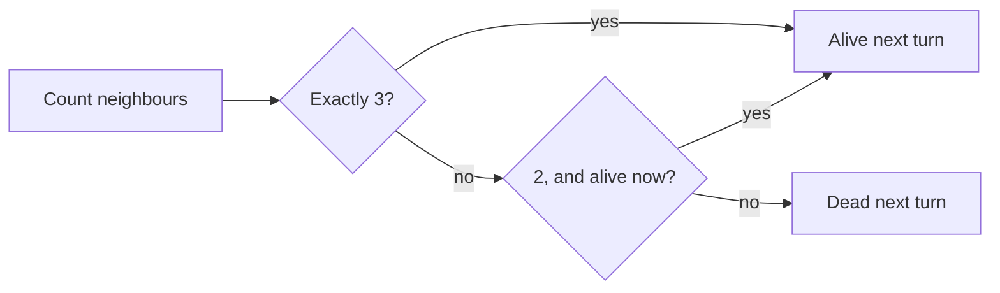

# Life

Conway's Game of Life in one HTML file. Draw on the board and watch it evolve.

## Rules

1. A live cell with two or three neighbours lives on.
2. A dead cell with exactly three neighbours comes alive.
3. Every other cell dies, or stays dead.

## How a cell decides

## Patterns

| Pattern | Period | Cells |
| ------- | -----: | ----: |
| Blinker |      2 |     3 |
| Glider  |      4 |     5 |
| Pulsar  |      3 |    48 |

- [x] Wraps around the edges
- [x] Tap or drag to draw
- [ ] Save a pattern

> Written by an agent overnight; read on the train.
