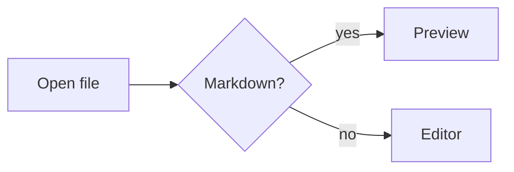
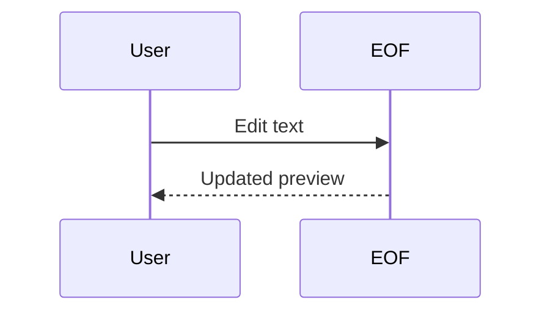

# Diagrams

A flowchart:



A sequence diagram:



A diagram with a mistake, which keeps its code and shows Mermaid's message:

```mermaid
flowchart LR
  A --> 
```

Ordinary code stays code:

```swift
print("hello")
```
